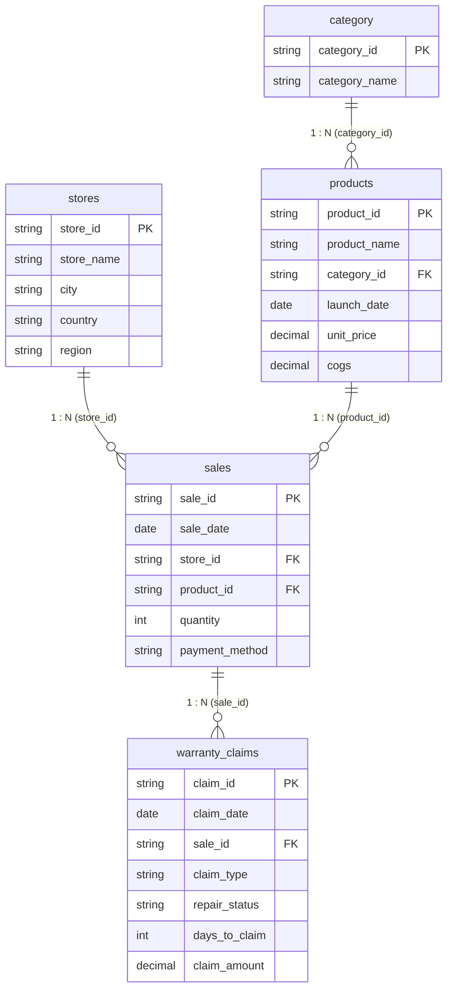

# 🍎 Apple Retail Sales & Warranty Analysis | PostgreSQL

[](https://www.postgresql.org/)
[-CC292B?style=for-the-badge&logo=sqlite&logoColor=white)](https://en.wikipedia.org/wiki/SQL)
[](https://python.org/)
[](https://opensource.org/licenses/MIT)

An end-to-end relational database analytics project querying global Apple retail sales, product demand, and warranty claims across **15 international flagship stores, 23 product lines, and 2,500+ transactions**. 

Designed to uncover store performance benchmarks, category pricing elasticity, and **early-life hardware failure patterns** using advanced SQL techniques.

---

## 📌 Business Objectives & Scope

1. **Store & Country Performance:** Compare store efficiency, average order value, and geographical revenue distribution across the Americas, Europe, Asia Pacific, and the Middle East.
2. **Product Demand & Growth Trends:** Track best-selling devices, category margins, and annual revenue trajectory using **Year-over-Year (YoY) growth calculations**.
3. **Warranty Reliability & Operational Gaps:** Segment warranty claims by repair status, quantify the financial absorption of replacements, and isolate **early-life failures (defects within 60 days of purchase)** to inform supply chain quality control.

---

## 🛠️ Relational Database Schema & ER Diagram

The database structure consists of 5 normalized tables with enforced referential integrity:



---

## 📂 Repository File Structure

```
Apple_Retail_Sales_SQL_Project/
├── stores.csv                     # 15 international flagship Apple Stores
├── category.csv                   # 6 primary hardware and accessories categories
├── products.csv                   # 23 Apple products with unit prices and COGS
├── sales.csv                      # 2,500 transactions from 2021 to 2024
├── warranty_claims.csv            # 350+ customer warranty claims with repair statuses
├── apple_retail.db                # Pre-populated local SQLite database
├── generate_apple_sales_data.py   # Dataset generator script
├── 01_schema_setup_postgres.sql   # DDL table creation, constraints, and indexes
├── 02_data_exploration.sql        # Initial sanity checks, row counts, and summary stats
├── 03_business_analytics_queries.sql # 12 production-grade SQL analytical queries
├── run_queries.py                 # Instant local query execution script
├── interview_qa_guide.md          # Interview elevator pitch, technical Q&A, and insights
└── README.md                      # Project documentation (this file)
```

---

## 🔍 Highlighted SQL Queries & Business Logic

### 1. Year-over-Year (YoY) Revenue Growth with `LAG()`
Tracks annual sales progression without expensive self-joins:
```sql
WITH YearlySales AS (
    SELECT 
        SUBSTR(s.sale_date, 1, 4) AS sales_year,
        ROUND(SUM(s.quantity * p.unit_price), 2) AS annual_revenue
    FROM sales s
    JOIN products p ON s.product_id = p.product_id
    GROUP BY SUBSTR(s.sale_date, 1, 4)
)
SELECT 
    sales_year,
    annual_revenue,
    LAG(annual_revenue, 1) OVER (ORDER BY sales_year) AS prior_year_revenue,
    ROUND(
        ((annual_revenue - LAG(annual_revenue, 1) OVER (ORDER BY sales_year)) / 
         LAG(annual_revenue, 1) OVER (ORDER BY sales_year)) * 100.0, 
        2
    ) AS yoy_growth_pct
FROM YearlySales
ORDER BY sales_year;
```

### 2. Early-Life Failures (<= 60 Days) Analysis
Isolates manufacturing defects occurring shortly after sale:
```sql
SELECT 
    c.category_name,
    COUNT(w.claim_id) AS total_claims,
    SUM(CASE WHEN w.days_to_claim <= 30 THEN 1 ELSE 0 END) AS under_30_days,
    SUM(CASE WHEN w.days_to_claim BETWEEN 31 AND 60 THEN 1 ELSE 0 END) AS days_31_to_60,
    SUM(CASE WHEN w.days_to_claim > 60 THEN 1 ELSE 0 END) AS over_60_days,
    ROUND(
        (SUM(CASE WHEN w.days_to_claim <= 60 THEN 1 ELSE 0 END) * 100.0) / COUNT(w.claim_id), 
        2
    ) AS early_life_rate_pct
FROM warranty_claims w
JOIN sales s ON w.sale_id = s.sale_id
JOIN products p ON s.product_id = p.product_id
JOIN category c ON p.category_id = c.category_id
GROUP BY c.category_name
ORDER BY early_life_rate_pct DESC;
```

### 3. Product Leadership per Category using `DENSE_RANK()`
```sql
WITH CategoryProductRank AS (
    SELECT 
        c.category_name,
        p.product_name,
        ROUND(SUM(s.quantity * p.unit_price), 2) AS revenue,
        DENSE_RANK() OVER (
            PARTITION BY c.category_name 
            ORDER BY SUM(s.quantity * p.unit_price) DESC
        ) AS rank_in_category
    FROM category c
    JOIN products p ON c.category_id = p.category_id
    JOIN sales s ON p.product_id = s.product_id
    GROUP BY c.category_name, p.product_name
)
SELECT * FROM CategoryProductRank WHERE rank_in_category <= 2;
```

---

## 📊 Key Business Takeaways

1. **Regional Demand Shift:** Asia Pacific (39.0%) and Europe (34.4%) surpassed the Americas in retail growth velocity, led by flagship demand in Mumbai (Apple BKC) and Milan (Apple Piazza Liberty).
2. **Margin Engines:** While iPhones generated the largest gross dollar volume, **Accessories & AirPods yielded gross margins exceeding 60%**, serving as critical basket-size profit drivers.
3. **Warranty Cost Concentration:** While only **25.3% of claims resulted in full device replacements**, they consumed **over 55% of the total warranty repair budget**, averaging $617 per claim. Early-life failures accounted for 36%+ of hardware issues, emphasizing the need for stricter pre-shipment component testing.

---

## 🚀 How to Run the Project

### Option 1: Instant Local Python Execution (Zero Database Setup Required)
Run all queries directly on your laptop using the included pre-populated database:
```bash
python run_queries.py
```

### Option 2: Run in PostgreSQL (pgAdmin / psql)
1. Open PostgreSQL / pgAdmin 4.
2. Create a new database named `apple_retail_db`.
3. Open Query Tool and execute [`01_schema_setup_postgres.sql`](01_schema_setup_postgres.sql).
4. Run [`02_data_exploration.sql`](02_data_exploration.sql) and [`03_business_analytics_queries.sql`](03_business_analytics_queries.sql).

---

## 👤 Author & Contact

**Pravin Ghule**  
- **Location:** Pune, India  
- **Email:** ghulepravin90@gmail.com  
- **Phone:** +91 7020353723  
- **Specialization:** Data Analytics | SQL (PostgreSQL, MySQL) | Python | Power BI
